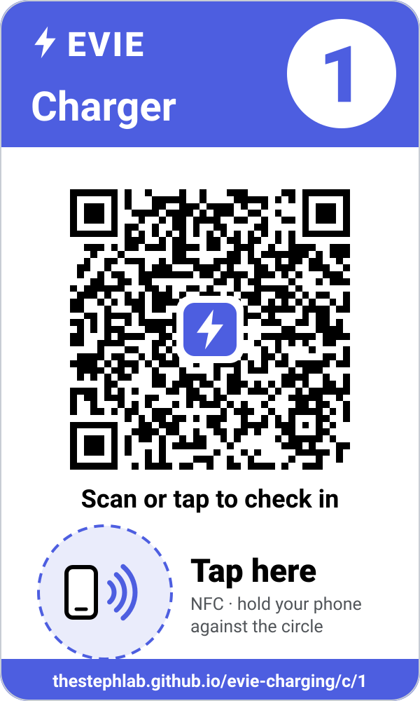

# EVIE charger stickers — QR + NFC

Each charger gets a 60 × 100 mm sticker. People **scan the QR code** or **tap their phone on the NFC circle**, and EVIE opens straight to *Check in to charger N*. If that charger is busy, EVIE says who's using it and opens *Join the queue* instead.



## Design

| Zone | Content |
|---|---|
| Header (teal band) | EVIE bolt and wordmark, **Charger** label, a large charger number in a white disc, readable from across the car park |
| Centre | A 40 mm QR code with error correction level **H**, so it survives scuffs and the EVIE logo in the middle |
| Call to action | **Scan or tap to check in** |
| NFC tap zone | A dashed 19 mm circle with a phone-and-waves icon and **Tap here · NFC**. Put the chip directly behind this circle. |
| Footer | The short URL in plain text, so people can check the domain before trusting the code |

Colours match the Hub: the EV-charging zone green `#0B7A52` and Roboto, with near-black ink on white for maximum scan contrast. The tap icon is a generic phone-and-waves mark. It doesn't use the NFC Forum "N-Mark" or the EMVCo contactless logo, because both are trademarks with usage rules.

## Generate

```bash
npm install                       # installs the qrcode dev dependency (not needed at runtime)
npm run stickers -- --base https://evie.example.com --chargers 3
```

Output goes to `stickers/dist/`:

- `charger-N.svg`: a single sticker at exactly 60 × 100 mm
- `sheet-N.svg`: an A4 print sheet, 6 stickers per page, with cut outlines

The script prints the link for each charger, for example `https://evie.example.com/c/1`. The **same link** goes in the QR code and on the NFC chip. `--base` defaults to `$EVIE_URL`, or `http://evie.local:3000` if that isn't set. The committed `dist/` files are built for the live demo at `https://thestephlab.github.io/evie-charging`. **If you host EVIE anywhere else, regenerate them with that URL before printing.**

> The short `/c/N` paths keep the QR code at version 3 (29 × 29 modules), so each module is about 1.4 mm and scans easily from 30–40 cm.

## Print

- **Material:** white polyester or vinyl with a matt laminate. Gloss glare makes QR codes harder to scan. Choose UV- and weather-resistant stock if the chargers are outside.
- **Scale:** print at 100% with no "fit to page". After printing, check that the QR code measures 40 mm.
- **Fonts:** the SVG uses system fonts (Inter, then Segoe UI, then Arial). For a print shop, open it in Inkscape or Illustrator and convert text to outlines. Add 2 mm of bleed if they ask for it.
- **Placement:** fix it at eye height next to the cable holster. Don't cover the charger's own RFID card reader, because it can interfere with the NFC tag.

## NFC chip

1. **Buy on-metal (anti-metal) NTAG213 tags, 15–20 mm round.** Charger housings are usually metal, and ordinary tags won't read on metal. NTAG213 holds 144 bytes, which is plenty for one URL.
2. **Write the link.** Use a free app such as *NFC Tools* (iOS or Android): *Write → Add a record → URL/URI* → `https://evie.example.com/c/1`.
3. **Lock the tag.** In NFC Tools, go to *Other → Lock tag*. Locking is permanent. It stops anyone overwriting the chip with a malicious link.
4. **Stick it on.** Fix the tag to the charger, centred where the dashed circle will be, then apply the sticker over it.
5. **Test it** with an iPhone (XS or later reads tags in the background, no app needed) and an Android phone with NFC turned on.

## Security notes

- Use **HTTPS** for the real deployment. It also enables EVIE's notifications and installing it as an app (PWA).
- QR stickers can be covered with a fake one ("quishing"). The printed URL and a locked NFC tag let people check they're on the right site. Check the stickers now and then.
- The links contain only the charger number. No personal data is stored on the sticker or the chip.
